 

<table width="100%">
  <tr>
    <td width="33%" align="center">
      
    </td>
    <td width="33%" align="center">
      
    </td>
    <td width="33%" align="center">
      
    </td>
  </tr>
</table>

<a href="https://www.linkedin.com/in/TWOJ-LOGIN">LinkedIn</a> &nbsp;·&nbsp;
<a href="https://github.com/xlvsh00">GitHub</a> &nbsp;·&nbsp;
<a href="mailto:twoj@email.pl">xlvsh.kontakt@gmail.com</a> &nbsp;·&nbsp;
<a href="https://twoje-portfolio.pl">Portfolio</a>

